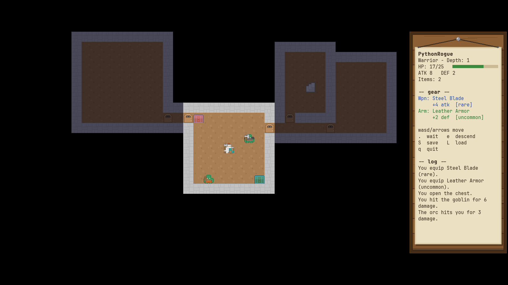

# PyRogue

A turn-based roguelike dungeon crawler, written in Python. Pick a class, fight your way down
procedurally generated floors, open chests for better gear, and survive the boss every eighth floor.
It plays in its own window with pixel-art tiles, or in a plain terminal.



## Download and play

Grab the zip for your system from the [Releases](https://github.com/eb2033/PyRogue/releases) page,
unzip the **whole folder**, and run:

- **Windows:** `PyRogue\PyRogue.exe`
- **Linux:** `PyRogue/PyRogue`

No Python needed. Keep the program next to its `_internal` folder. The build isn't code-signed, so
Windows SmartScreen may say "unknown publisher": choose **More info → Run anyway**. Each release
lists `SHA256SUMS` to check your download against.

## Run from source

The terminal version needs nothing but Python 3.12+ (on Windows, also `pip install windows-curses`):

```bash
python3 main.py
```

The window version needs [pygame-ce](https://pyga.me):

```bash
python -m venv .venv
.venv/bin/pip install -r requirements.txt
.venv/bin/python main.py --renderer pygame
```

## How to play

| Key | Action |
|---|---|
| `W` `A` `S` `D` | Move. Walk into a monster to attack it. |
| Arrow keys | **Warrior:** move. **Archer:** shoot an arrow that way. |
| `.` | Wait a turn |
| `e` | Go down the stairs (`>`) when you're standing on them |
| `S` / `L` | Save / load (Shift+S, Shift+L) |
| `q` | Quit |
| `F11` | Fullscreen (window version) |

Menus also take the mouse in the window version.

- **Classes.** The **Warrior** fights in melee. The **Archer** has less health but shoots arrows
  along a straight line, hitting the first monster in the way.
- **Line of sight.** You see only what's in view; rooms are hidden behind closed doors until you
  step into the doorway. Places you've seen stay on the map, dimmed.
- **Chests.** Walk onto one to open it. **Pink** chests hold a healing potion, **cyan** ones a
  weapon or armour. Gear comes in four rarities (common, uncommon, rare, epic) and is equipped
  automatically if it's better than what you're wearing. Loot gets better the deeper you go.
- **Combat zoom.** In the window, a melee fight zooms the map in on you and your opponent, blows
  flash with the damage, and it zooms back out when the fight ends (Warrior only for now). Any key
  skips the animation.
- **Monsters** get tougher every three floors. Every eighth floor has a **boss**, which drops a
  chest with rare or epic gear.

## Settings

Optional, in a `.env` file next to the program (or next to `main.py` from source), one `KEY=value`
per line:

| Key | Default | |
|---|---|---|
| `MAP_WIDTH`, `MAP_HEIGHT` | 50, 20 | Map size in tiles (a source checkout's `.env` sets 40x20) |
| `FOV_RADIUS` | 6 | How far you can see |
| `TURN_DELAY_MS` | 110 | Pause between monster moves; `0` makes them instant |
| `TILES` | 1 | `0` draws letters instead of tiles in the window |
| `COMBAT_ZOOM` | 1 | `0` keeps the whole map in view during melee fights |
| `RENDERER` | `curses` from source, `pygame` in the download | `curses` or `pygame` |

Saves and `crash.log` go to your user data folder: `%APPDATA%\PyRogue` on Windows,
`~/.local/share/pyrogue` on Linux, `~/Library/Application Support/PyRogue` on macOS.

## Development

```bash
.venv/bin/pip install -r requirements-test.txt -r requirements-lint.txt
.venv/bin/python -m unittest discover -s tests -v   # tests (pygame ones run headless)
.venv/bin/ruff check . && .venv/bin/ruff format .   # lint + format
.venv/bin/pyright && .venv/bin/vulture              # types + unused code
./packaging/build.sh                                # build the Linux zip into dist/
```

CI runs all of these on every push. `git config blame.ignoreRevsFile .git-blame-ignore-revs` keeps
the one-off formatting commit out of `git blame`.

The Windows build is made by CI (`packaging/build.ps1` on a Windows runner); pushing a `v*` tag
publishes a release. `CLAUDE.md` describes how the code is laid out, `CHANGELOG.md` what changed,
and `packaging/NOTES.md` how the build and releases work.

## Credits and licences

PyRogue is MIT-licensed (see `LICENSE`).

- Art: Kenney's [Roguelike RPG Pack](https://kenney.nl/assets/roguelike-rpg-pack),
  [Roguelike Characters](https://kenney.nl/assets/roguelike-characters) and
  [Roguelike Caves & Dungeons](https://kenney.nl/assets/roguelike-caves-dungeons), CC0. Thank you,
  Kenney.
- Font: [JetBrains Mono](https://www.jetbrains.com/lp/mono/), SIL Open Font License 1.1.
- Window and input: [pygame-ce](https://github.com/pygame-community/pygame-ce) (LGPL-2.1) and the
  libraries it bundles.

The downloads include `THIRD_PARTY_NOTICES.txt` and a `licenses/` folder covering every bundled
library; `assets/ASSETS.md` records where each art file came from.

Developed using Claude Opus 5.
